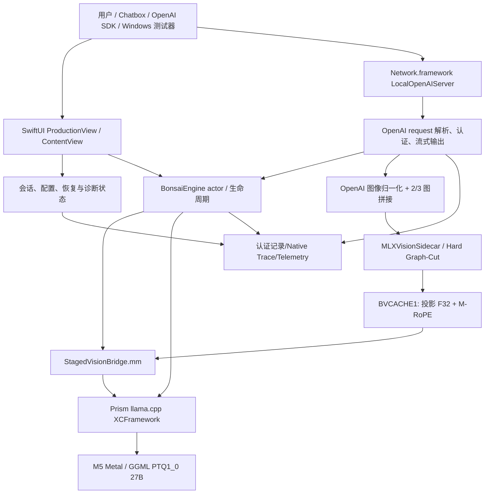
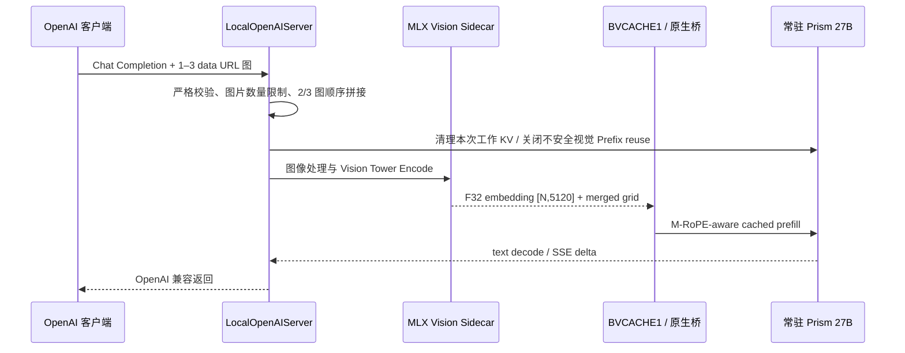

# Bonsai iPad / LLMoniPad 项目全景调研与工程交接报告

> **研究类型**：项目尽调 / 架构审查 / 历史复盘 / 现状评估 / 新开发者入职文档  
> **调研截点**：2026-10-11 21:11（UTC+08:00）左右，GitHub 记录可能继续变化  
> **目标仓库**：[`MyHerbTea/bonsai-ipad-prob`](https://github.com/MyHerbTea/bonsai-ipad-prob)  
> **文档版本**：Research & Handoff 1.0（只读研究，未修改产品仓库）  
> **面向读者**：没有参与过本项目的 Swift/iOS、Metal/llama.cpp、自动化测试或 AI 推理系统开发人员

## 执行摘要：先读这十条

1. **产品使命**：在一台 **iPad Pro 11 英寸 M5、12GB RAM、iPadOS 27.0.1** 上本地运行 **Ternary-Bonsai-2-27B-PTQ1_0.gguf**，以真实可用性为目标，而不是仅证明“模型能加载”。产品应支持文本会话、有限多图视觉、局域网 OpenAI Chat Completions、长上下文、合理的输出上限，以及一键自动化验收。硬件数据来自项目设备记录；GitHub 代码本身不代表自动支持其他 iPad 型号。
2. **项目实质**：这是一个深度集成工程：**SwiftUI App + Swift 状态/服务层 + Prism llama.cpp/Metal 推理 + Objective-C++ 原生桥接 + MLX Swift Vision Tower**。27B 推理由 Prism 负责；MLX 负责独立视觉编码，并非同时运行另一个 27B MLX 语言模型。
3. **最重要的历史转折**：早期使用 `mtmd` 的视觉编码与完整 27B 常驻模型相冲突。团队先实现分阶段视觉缓存（BVCACHE1），再用 MLX Vision Sidecar、Hard Graph-Cut 和 Live Injection，让视觉特征注入常驻 Prism llama 上下文，避免同时常驻两套重型执行资源。
4. **工程上的稳定不等于产品上的稳定**：GitHub Actions `success` 只能证明相应代码及编译/静态/离线测试通过；**只有 M5 真机持续运行及语义/性能/崩溃测试**才能证明候选版本可推广。
5. **明确冻结的真机基线**：`RC1.25.3 Build 64`（2048 Context，多图/图后文本/原生 Prefill 隔离相关）有仓库基线清单；`RC1.26 Build 75`（2048 Context，32/32 Batch、API 冷启动）有独立认证检查点。这些认证不外推到 32K。
6. **长上下文已有突破，但未全部收敛**：Build 79 记录了 6144、8192、16384 Context 的 M5 真机通过。32K 经 Build 80–89 的上下文创建与 GGML 分配修复后有部分可用证据，Build 103 的实际输出预算行为有真机记录，但**未建立 32K 长输入、长时、全功能、跨重启的统一冻结认证**。64K 更不能宣称生产稳定。
7. **2026-10-10 的事故链**：Build 103 修复 OpenAI API 隐形 256 输出上限；Build 104 尝试 B24 自动偏好和 32K 双序列 KV checkpoint，M5 启动 API 时直接退出；Build 105 回退到 `n_seq_max=1`，隔离 KV 优化并关闭自动 B24 以求恢复启动。双序列的因果责任**仍属于假设**，不能只凭稀疏原生 trace 判根因。
8. **当前 CI 状态**：Build 105 分支 `4c25b0a...` 已有 GitHub Actions 成功（65 步、生成 unsigned IPA），但报告时点未见同一二进制完整真机认证。Build 106 `3729149...` 正在开发，初始检查到的 Actions 失败，具体是旧 `Build93` 源码契约仍要求工程 Build=105，与 Build=106 不符。此后构建还出现 Build89/90 合约失败；见末尾动态状态附记。失败属于门禁不一致，不代表已测出 GPU 推理故障。
9. **重大仓库导航陷阱**：默认分支 `main` 只到 **RC1.23.1**（SHA `a032634d...`，约 60 个树节点）；真正的 RC1.26 工作位于独立长命名分支。**新开发人员绝对不能将 `main` 当作最新产品源码**。
10. **接手优先级**：先封存 Build 64/75/105 及真机证据 → 修复 Build 106 的 CI 身份契约 → 小成本验证 M5 上真实 32K API 启动与完整功能 → 在同一冻结工作负载下测性能、内存和连续请求 → 再决定是否推广 B16/B24 或继续优化内核。禁止把尚未真机验证的优化直接变成默认值。

---

## 1. 研究范围、方法与证据纪律

### 1.1 实际检查对象

本报告通过已连接的 GitHub 访问接口，对公开仓库做了以下检查：仓库元信息、默认分支、全部返回的分支名称与 HEAD、递归文件树、主要 Swift/Objective-C++ 核心文件的代码结构与关键调用点、约二十多份有代表性的历史/架构/真机证据文档、RC1.26 Build 75/79/81/82/89/102/103/104/105/106 设计文档、CI workflow、Actions 运行结果与失败日志、Build 105 产物及 Build105→106 提交差异。还查看了仓库的 PR/Issues 搜索结果（在查询时未返回记录）。

**仓库树快照**：`main` 约 60 条 tree 记录；Build 105 分支 269 个文件；Build 106 分支 276 个文件。已核对全部列出的路径目录，而不是把默认 README 当作唯一真相。没有逐行审计全部 276 个文件，也没有在 M5 设备上重新运行性能实验。对既有实验结论仅根据归档文档/代码/运行记录陈述，不虚构验收。

### 1.2 证据分级（整篇通用）

| 等级 | 含义 | 可以得出的结论 |
|---|---|---|
| **D：Device-certified** | 有冻结的构建身份、真机日志和明确的测试范围 | 仅证明该设备、该配置、该用例范围 |
| **C：CI-verified** | 源码契约、编译和产物检查通过 | 可以签名安装测试，不等于设备可用 |
| **S：Source-implemented** | 代码存在，文档描述功能；缺少完整真机结果 | 功能候选，不自动视为成功 |
| **H：Hypothesis / diagnosis** | 源码与现象支持怀疑，但证据不能确定根因 | 可作为实验方向，不能写成已证实结论 |
| **P：Planned** | 仅计划或候选优化 | 不代表存在完成的实现 |

### 1.3 重要术语

- **RC**：Release Candidate / 开发迭代序列。与 App `CFBundleVersion` 对应的 Build 号**不是**同一层概念。
- **冻结基线**：标记了源 SHA、二进制、真机条件和验收范围的可回滚节点。分支名前缀为 `frozen-*` 不自动说明任何新需求已被验收。
- **Prefill / Decode / TTFT**：输入提示处理、逐 token 输出，以及首 token 延迟；不能混为一个“速度”。
- **Context capacity vs utilization**：分配 32768 token 的 KV/运行时能力，不意味着已用满 32768 token 真实输入进行过稳定和性能认证。
- **n_batch / n_ubatch**：创建 llama context 时确定的逻辑/微批形状，非可随 HTTP 请求动态切换的参数。
- **KV checkpoint / hybrid recurrent**：该架构包含混合状态，不能简单套用普通 Transformer KV cache 可任意裁尾或跨轮恢复的假定。
- **BVCACHE1**：项目在视觉编码与原生语言 Prefill 间交换投影 embedding、位置元信息的缓存边界。

---

## 2. 项目起点：为什么要做，成功标准是什么

### 2.1 背景及约束

用户没有 Mac 作为本机开发设备，主要采用 **Windows + PowerShell/Codex + GitHub Actions 的 macOS 构建机 + 一台真实 iPad**。因此开发流程不能依赖用户在本地手动 Xcode 编译、频繁改复杂 JSON 配置，或每次微调都拆出若干安装版本；理想交付物是一次安装的候选 IPA、一个 Windows 一键集成测试包及一个统一结果 ZIP。

产品意图依次覆盖：文本模型真实生成 → Vision 本地端侧推理 → 文本/视觉 API 对外服务 → 相同会话和后续提问 → iPad 端稳定的内存生命周期 → 提升合理吞吐、TTFT → 拓展到可用长上下文 → 形成可重复、保守和可回滚的高性能引擎。

### 2.2 功能性目标与边界

**计划的产品能力**：本机文件导入 GGUF、选用独立 Vision Tower；本机 SwiftUI 图文操作；LAN OpenAI-compatible `/v1/models`、`/v1/chat/completions`；Bearer 或 X-API-Key 认证；标准 JSON 与真正增量 SSE；多轮消息历史、最多 3 图（通过 contact sheet）、错误分类、诊断导出、可配置输出预算。

**不应对外承诺**：Responses API、工具实际执行、通用 reasoning API、远程图片 URL 抓取、任意多图独立视觉 token 插入、iPad 后台长驻服务、并行多请求调度，以及已验证的 64K/256K 生产上下文。模型的理论训练 Context ≠ 当前设备可持续分配的 Context。

**验收目标排序**（工程建议）：真机不崩溃/可恢复 > 语义正确与功能连续 > 明确模型和运行参数身份 > 可用 Context 与输出长度 > 在代表性任务上的 Prefill、TTFT、Decode 吞吐 > 单次峰值跑分。

---

## 3. 高层系统架构与真实数据流

### 3.1 分层架构



**产品入口**：`BonsaiLab/BonsaiLabApp.swift`，SwiftUI 的 `ProductionView.swift`（对用户）与 `ContentView.swift`（实验/诊断）。`project.yml` 由 XcodeGen 生成 iOS 工程；target 是 iPad，deploymentTarget iOS 17、Swift 5、C++17。引入 `MLXSwift` 0.31.3 的 MLX/MLXNN，连接 `Vendor/llama.xcframework`、Metal、Network、Accelerate、Security。

**文本推理层**：`BonsaiEngine.swift` 是主要 `actor`，负责导入和加载 GGUF、`llama_model_load_from_file`、`llama_context_default_params`、`llama_init_from_model`、Prompt 模板/Tokenization、采样、输出分片、KV 状态、取消/卸载与诊断。它使用 Prism 的 27B PTQ1_0 和 Metal，未把 27B 语言生成整体改写为 MLX。

**本机 HTTP 层**：`LocalOpenAIServer.swift` 使用 Apple Network.framework (`NWListener` / `NWConnection`) 接收请求；解析 HTTP、分块传输、鉴权、限流/串行推理关联、JSON/SSE、OpenAI 错误封装，并暴露诊断接口。运行前必须由 `ProductionView.startAPIServer()` 做资源预热、捕获选择的资源和输出策略。

**视觉层**：`OpenAIMultimodal.swift` 严格归一化 data URL；`OpenAIMultiImageComposer.swift` 将 2/3 张图片按次序拼成有界 contact sheet；`BonsaiMLXVisionSidecar.swift` 负责 Vision Tower 权重和推理；`StagedVisionBridge.mm/.h` 负责缓存格式、预处理及 llama 图片特征注入，另有 `MTMDProbeBridge` 和 `SystemProbeBridge` 供底层探测。

**配置/策略层**：`LabTypes.swift` 定义 RuntimeConfig/GenerationConfig；`RuntimeOptimization.swift` 保留不同 Phase 的实验开关/记录；`Build94BatchExperiment.swift` 用持久化状态约束候选 Batch；`Build105StartupRecovery.swift` 负责危机迁移；Build106 新增 `M5RuntimeGovernor.swift`，作用是把已批准的启动 arm 映射到实际 context-create profile，而非动态吞吐调度器。

**记录与自动化**：`CertificationRunRecorder.swift`、持久化 UserDefaults 状态、原生 trace；`tools/*.py/*.swift/*.ps1/*.cmd`；`device_tests/`；GitHub Actions 负责真机目标架构编译、合约测试、打包无签名 IPA、附加 Windows 工具。

### 3.2 文本请求执行链

1. `ProductionView` 根据选中的 GGUF、Context、Batch、offload 和实验性持久策略建立运行配置。
2. `BonsaiEngine.loadModel` 设置 M5 `GGML_METAL_TENSOR_DISABLE` 环境策略、mmap、模型 GPU 层数，加载 GGUF，并建立 llama context。
3. `LocalOpenAIServer` 校验 `/v1/chat/completions`，将 role/content 历史归一化；解析 `max_tokens` / `max_completion_tokens` / `max_output_tokens` 及 sampling 选项。
4. 引擎完成 Prompt 拼接、Tokenizer、Context admission、分块 `llama_decode` Prefill、token sampling 与 Decode；SSE 按 token delta 分片发送，非流模式输出 JSON。
5. 记录实际 prompt/completion token 数、Prefill/Decode、结束原因、热状态等。实验性复用策略以明确 arm/state 与证据门槛为前提。

### 3.3 视觉请求执行链及为什么不能简化



原因与约束：**早期 mtmd 与常驻 27B 共存曾导致 iPadOS 进程退出**。RC1.21 将视觉编码和文本阶段强行分离，RC1.22/1.23 才允许 MLX 视觉侧车与 Prism 语言 Context 共存。最初单图 API 将图像放入固定 user 输入布局，不等于自由交错的任意视觉片段。RC1.25 的多图适配是 `1024×512` 上限的拼接，不是 n 份独立多模态 embedding：能力、OCR 清晰度、图像数量和排序受到适配器约束。外部 API 视觉 Prefix-KV 在 Build64 后被明确禁用，以避免后续图请求在原生 prefill 阶段失去隔离。

---

## 4. 历史始末：从能运行到产品化再到 32K 性能

| 阶段 | 工程问题/目标 | 主要方案或结果 | 证据级别与注意事项 |
|---|---|---|---|
| RC1.4–1.10 | iPad 内存问题、视觉加载闪退 | 隔离 `vocab-only`、Q8 mmproj、图像投影缓存与完整模型加载；形成 staged-vision 生命周期 | 根据 `PRODUCTIZATION_PROTOCOL` 的历史复盘；勿把早期二进制当现行 API |
| RC1.11 | LLM 上下文加速 | Flash Attention、KQV/Op offload 及 M5 的 Metal Tensor workaround；记录原始文本/视觉安全核心 | 历史实机 PASS；从此引入推理核心冻结机制 |
| RC1.12–1.13 | 从 Lab 变成 App + LAN API | Production UI、质量档位、回退和 `OpenAI` 风格接口 | 产品化阶段，参见 Protocol |
| RC1.15–1.20 | 一次编码多次复用与真流 | resident model/context、image cache、热会话、真正 SSE、`stream_options.include_usage` | 对缓存命中和生命周期逐步施加真机门槛 |
| RC1.20.x | text API 冷/热一致，强制非 thinking | 修复 API 崩溃保护、Context admission、固定模板；`RC1.20.7` 文档称 frozen text API | 文本能力的历史关键基线 |
| RC1.21.0–1.21.2 | mmproj 与 27B 同驻冲突 | 两阶段缓存格式 `BVCACHE1`，编码后完全释放投影相关资源，注入常驻 27B | 架构调整，解决的是生命周期问题而非单纯吞吐 |
| RC1.22.0–1.22.5 | 视觉仍需频繁切模型 | MLX Swift Vision Tower，layerwise / streaming weights / Hard Graph-Cut 控制峰值内存 | 视觉侧车稳定证据；只加载 Vision Tower，不加载第二个语言模型 |
| RC1.23.0–1.23.1 | 完整 Live 图文 API | MLX F32 projected embeddings + M-RoPE → BVCACHE1 → llama prefill，HTTP 多模态错误契约 | 单图路径形成架构基础 |
| RC1.23.2–1.23.4 | 观测、会话重用、生成性能 | 路由指标、Prefix/reuse，Build46 冻结；逐阶段性能实验 | 注意有些实验“无安全收益”，没有强行推广 |
| RC1.23.5 | suffix-prefill / 256 Context 假设 | 真机对照未找到安全优势，明确 `NO SAFE WIN FOUND` | 被拒绝实验，后续禁止复活为默认 |
| RC1.23.6 Build49–54 | Stop/Resume 重启竞态 | listener awaited cancel、保持 27B 常驻、产品控制接入 | Build54 为有据的生命周期开发节点；在途请求排空需继续注意 |
| RC1.24.0 Build55 | 连续请求速度衰减 | Full 第 1→10 个请求约 13.59→8.07 tok/s，空闲 60 秒左右可恢复 | D：真机诊断，未直接证明特定 GPU 频率机制 |
| RC1.24.1 Build56 | 明确 Flash/KQV/Op 的增益 | Full 十请求均值 9.170 tok/s；KQV 是最大单项贡献 | D：512 Context、固定输入/输出，不得外推 32K |
| RC1.25.0 Build57 | OpenAI 1–3 图 | 2/3 图 bounded contact sheet，单/双图与拒绝错误等 6/6 | D：冻结多图功能基线 |
| RC1.25.1 Build60 | UTF-8 与 Context 双预算 | 修正 `vision_multi` 记录、UTF-8 JSON、M-RoPE logical/KV physical admission | D：冻结多图可靠性基线 |
| RC1.25.2 Build61–63 | 客户端 SDK、切 Context、多图 follow-up | OpenAI Python/JS probes；Build62/63 视觉 follow-up 原生 prefill 附近闪退 | 部分用例成功，但这组崩溃阻止了更大范围稳定声明 |
| **RC1.25.3 Build64** | 视觉请求之间原生缓存干扰 | API vision 请求清除 Prefix snapshot 与工作 KV，再 MLX encode / prefill，不丢常驻模型 | **D：冻结主基线之一**，manifest Context=2048 |
| RC1.26 Build68–74 | 借鉴 Backburner、测 Batch 梯度 | Phase2 内存/Metal Tensor、Prefill batch 8→16→32→64 | 多项 A/B；不能按历史不同负载直接排序 |
| **RC1.26 Build75** | API Cold Start 稳定 | 2048 Context、32/32 Batch、Metal Tensor OFF，真机 READY | **D：独立稳定检查点**，非 32K 核心基线 |
| RC1.26 Phase2G | 连续 decode 衰减 | 60 秒 idle 恢复，15 秒 pacing 缓解；**不自动降档、不强行 cooldown** | 已关闭实验，不是产品补丁 |
| RC1.26 Build76–79 | 2048 太小；追求更长 Context | KV 精度分段、mmap、GPU layers 协同；6144/8192/16384 真机 PASS | D：以已报告档位与条件为限 |
| RC1.26 Build80–82 | 32K 启动闪退 | 从降低 GPU 层数转向统一 Metal/共享内存假说 | 多版失败诊断；不代表 32K 可用 |
| RC1.26 Build83–89 | GGML 32K context/scheduler 失败 | Metal KV layer sharding；原生 trace；scheduler reserve/mmap；Build89 缩小 metadata 预算 | 定位 `malloc(550227616)` / ENOMEM；代码级修复需设备验收 |
| RC1.26 Build90–94 | 32K 上真实测量 Prefill 与 Batch | 统一身份、tokenize 后真实计数、Build94 8/16 guarded arm 与 SAFE4 | 独立 A/B；不可将讨论中的 GPU 内核假设当既定事实 |
| RC1.26 Build95–100 | 原生 PTQ1_0 / GDN / 向量化性能候选 | Build100 32K B16 有真实测量；实验路线有回滚保护 | 939 token Prefill B8 119.70 s、B16 35.25 s，属于指定任务测试 |
| RC1.26 Build102 | 32K B16/B24/B32 孤立试验 | 规定 B16→B24→B16 验证和 B32 严格人工同意 | 初始方案文件声明 Source Candidate；后续报告提及 B24 增益，需绑定实际证据 ZIP |
| **RC1.26 Build103** | API 默认输出限制误伤可用性 | 去掉隐藏 256 截断；按实际 prompt tokens / 视觉位置控制预算；全阶段测试整合 | 仓库文档报告真机大于 256 的输出，不等于全部 32K 场景冻结 |
| **RC1.26 Build104** | 自动 B24 + 双序列 32K KV checkpoint | 期望性能/一致性整合，但 M5 一开 API 进程退出 | **失效候选**；可疑根因不等于已证明根因 |
| **RC1.26 Build105** | 修复 Build104 启动问题 | `n_seq_max=1`，KV quarantine，B24 默认关闭，保留 Build103 输出能力 | **C：65-step Actions SUCCESS / unsigned IPA**；等待完整真机 PASS |
| **RC1.26 Build106** | M5 Runtime Governor | SAFE4 / BALANCED8 / PERFORMANCE16 / TURBO24 / LEGACY32 映射与调试接口 | **S/CI-failing at cutoff**；尚不可按 Stable 发布 |

### 4.1 关键技术决策的因果关系

**为什么不让 mmproj 和 27B 一直一起跑？** 早期被真机内存和进程死亡否决；分阶段释放、MLX 侧车、Hard Graph-Cut 是因果链结果。重写 MLX/mtmd 可能重引入旧问题。

**为什么 32K 不断变换 GPU layers 和 Batch？** 起初怀疑长 Context KV 内存线性增长；Build79 成功到 16K。随后发现部分 CPU/Metal 混合计算及 GGML scheduler 元数据申请可能放大 32K 初始化峰值，因此由“极端减少 GPU layers”转为测试“统一 Metal + patch Prism + bounded scheduler metadata”。这些都是各自构建和真机条件下的假设检验，不能单凭某版成功便宣称彻底修复全部长上下文问题。

**为什么 Build105 必须隔离 Build104 KV？** Build104 的新增双序列使已存 UserDefaults 设置可能跨升级重复触发高风险启动；Build105 一次性迁移关闭自动 B24/B16，并强制 `n_seq_max=1`，保留失败 sticky SAFE4。这是防止 crash loop 的安全设计，不等于完成 KV 重用功能。

---

## 5. 当前仓库与版本真实状态

### 5.1 分支不是按“最新名字”排序就可以选

| 用途 | Ref / SHA（调研截点） | 正确理解 |
|---|---|---|
| 默认入口 `main` | `a032634d992f3b2edf0b3665e9b381ee4d6c06cf` | 旧 RC1.23.1；源码/工具不完整，非当前产品开发入口 |
| 冻结多模态根基 | `frozen-v1-rc1-25-3-build64-device-certified` `0d84e106...` | 有 manifest、2048 真机检查；第一层可回滚历史锚点 |
| Build75 stable checkpoint | 文档认证 commit `c09b2e09706dd0c0391b7a15727da57e0f17d425` | 2048、Batch32 API cold-start 证据，不等于 32K |
| RC1.26 长期开发实验线 | `lab-v1-rc1-26-backburner-runtime` `c0e21aa6...` | 包括 Build75–81 的历史与 Backburner 融入，非“最新 Build” |
| **最近已通过构建** | **`lab-v1-rc1-26-build105-startup-recovery`** `4c25b0abd79d316754b0e612ab7c5fa53cabffd6` | 报告截至目前最适合检查的较新可构建候选；**不是已认证 Stable** |
| **当前快速演进的开发分支** | **`lab-v1-rc1-26-build106-m5-governor`**：本文代码快照 `37291498aed19cc357f8a53ec8115d7b9be482e3`；截至复核又推进到 `184324263fcf7036da022ddb5c402898bd679c1b` | 旧快照相对 Build105 增加 15 提交/13 文件；最新 HEAD 持续变化，CI 仍在调试，未真机认证 |
| 平行 feature 分支 | `feature/build106-m5-runtime-governor` `ad1fd874...` | 名称相似但 SHA 不同；必须做差异审查，不能默认等同 Build106 lab 分支 |

所有 SHA 为调研时点。**不要从 `/debug/build.baseline_commit` 推断已安装产品 SHA**；该字段可能指向祖先冻结基线。正确关联 GitHub Source/IPA、安装 App build 和原生 trace 身份。

### 5.2 GitHub CI 现场证据

- **Build105**：`Actions run 38070840581`，2026-10-10 完成，**success**，job 65 steps，全通过；产物 `BonsaiLab-iPad-v1-RC1.26-Build105-Safe-Startup-Recovery`（Artifact ID `11676354546`，约 7.9 MB）。
- **Build106**：`Actions run 38142193090`，2026-10-11 13:11Z 启动，已检查到 **failure**。第一个失败步骤是 `Build93 and Build94 executable rollback lifecycle and integration contracts`，原因 `tools/rc126_build93_contract_tests.py` 仍 `assert 'CURRENT_PROJECT_VERSION: "105"' in project`，而当前 `project.yml` 已为 `106`；发生在产品完整 build 之前。不能据此判定 MLX/Metal 运行失败。该 run 无 artifact。
- CI 命中 `cancelled` 并不等于功能失败；多次推送因 `concurrency: cancel-in-progress: true` 正常取消前序 run。不要把取消记录加入“失败率”。
- 本仓库调研时未列出 GitHub Releases；**发布形态主要是 workflow artifacts + 分支/文档/手动真机认证**，而非标准 release/tag 产品链。

### 5.3 今日可合理声称的能力/状态矩阵

| 范围 | 源码能力 | 已记录的代表性实机证据 | 当前最重要缺口 |
|---|---|---|---|
| PTQ1_0 文本 27B | 已实现 | 多次真机生成；Build56/75/103 各有部分证据 | 连续用户负载、速度一致性与质量基线 |
| Text API / JSON / SSE / multi-turn | 已实现 | 早期 RC/Build64/75 真机链 | 新候选统一全套回归 |
| 视觉单图、2/3 图 | 已实现，contact sheet | Build57/60/64 冻结/记录 | 高分辨率 OCR、长对话、跨请求语义与内存 |
| 图后文本继续可用 | 已实现隔离 | Build64 认证范围 | 32K 新版本的图→文生存与多轮 |
| 工具调用/Responses API | 明确不支持 | N/A | 不应假装兼容 |
| 2048 Context | 已实现 | Build64/75 明确真机认证 | 不是用户最终想要的 Context |
| 6144 / 8192 / 16384 | 已实现分段 KV | Build79 文档明确真机 PASS | 各档完整 API/视觉/长时场景矩阵仍需审阅 |
| 32768 Context | 已有多轮 native 修复和实际运行证据 | Build103 真实较长输出；Build104 崩溃；Build105 无本报告所见真机全面 PASS | 启动可靠、长输入利用率、长时内存/性能、一键多功能认证 |
| 65536 Context | 实验设计/配置 | 未检出完整冻结认证 | 不宜列为生产能力 |
| M5 启动时 Batch Govern | Build106 源码存在 | 构建 CI 尚失败 | 修复 CI + M5 验证 selected profile = actual batch |
| 32K 双序列 KV/复用 | 已实验过，现强制隔离 | Build104 进程异常；Build105 quarantine | 不能恢复默认，也不能宣称 KV 加速 |

### 5.4 现存直接影响开发的 Bug / 风险

**P0 — Build105 的 32K 真机最终结果不完整**。GitHub 的成功构建无法排除安装后的 `MODEL_LOAD_BEGIN` / Context 建立原生异常；如果仍崩溃，不应反复强制启动相同危险配置。

**P0 — Build106 CI 身份测试落后**。新分支引入 Build106 的 `project.yml`，但继承测试硬编码 Build105；先修测试断言身份契约且确保真实功能门禁未被删除、未被盲目改成通配 PASS。

**P0 — 产品入口身份混乱**。main、历史 frozen、Build105、Build106、feature 分支同时存在；`project.yml`、`/debug/build`、启动原生 trace、CI artifact 必须一致。历史已有 trace `build=89` 兼容字段不等于 App Build 号的先例。

**P1 — 32K 的 KV/Prefill 性能**。Batch 改善对短/中等输入有影响，但不可从 939-token/32-output 实验外推出满载 16–32K 输入、视觉或持续 decode。`post_generation_tail_trim_failed` 已明确尚未解决，Build105 没有启用复用。

**P1 — API 生命周期**。必须保护 `stopListenerPreservingHandler` / awaited listener cancel / asset 切换后全量释放。早期 Build49–54 的竞态说明“API stopped”与“引擎完全释放”不能随意混合。

**P1 — Vision 语义质量与“多图”表象**。拼接后再降采样，和独立 3 图 token 并不等价；应测试 OCR、人物/图片左右关系、后续追问、错误后的存活性。

**P1 — 安全与可审计**。GitHub 默认公开，模型 GGUF/vision weights 不在 IPA 内；没有在已查看文件树找到仓库根部统一 LICENSE（需由维护人核查分发权利/第三方许可）。模型哈希在 Build64 manifest 仍为 `null`，影响完全可重现的设备证明。Windows 工具不能记录 API Key 或用户实际提示词/回复。

---

## 6. 关键源码索引：新开发者从哪里读起

**阅读顺序与职责**（下面的文件均在 Build105/106 活跃分支确认存在；默认 main 不一定有）：

| 文件 | 核心职责 | 优先关注的符号 / 易出错边界 |
|---|---|---|
| `project.yml` | XcodeGen iPad 项目、Build 身份、MLXSwift/Prism 依赖 | `CURRENT_PROJECT_VERSION` / iOS target / embedded framework |
| `.github/workflows/build-ios.yml` | macOS Runner、Prism pin+patch、合约测试、unsigned IPA+一键工具 | 原生修改补丁顺序、Xcode 编译、artifact 对应 SHA、stale test asserts |
| `BonsaiLab/BonsaiLabApp.swift` | SwiftUI 主入口 | 根视图和生命周期 |
| `BonsaiLab/ProductionView.swift` | 用户界面、API cold start、配置构建、Asset 管理、认证快照 | `startAPIServer`、`applyBuild82LongContextPolicy`、`startOrResumeAPIServer`、`copyAPIConfig` |
| `BonsaiLab/ContentView.swift` | 开发/实验 UI | 调参、Probe 与安全隔离 |
| `BonsaiLab/LabTypes.swift` | RuntimeConfig/GenerationConfig、指标、错误类型 | Context / Batch / 输出数校验 |
| `BonsaiLab/BonsaiEngine.swift` | 原生 27B 推理 actor、加载/上下文/Prefill/Decode、KV 管理 | `loadModel`、`makeContext`、`generateText`、`generateCachedVision`、`prepareForAPIVisionEncode`、`unloadAll` |
| `BonsaiLab/StagedVisionBridge.mm/.h` | Objective-C++ / C++ Prism 桥、BVCACHE1、多模态 M-RoPE、native trace | `BonsaiWriteProjectedVisionCache`、`BonsaiPrefillCachedVision`、分阶段定位 |
| `BonsaiLab/BonsaiMLXVisionSidecar.swift` | MLX Vision Tower, Hard Graph-Cut, layerwise 权重 | `encodeForInjection`、`cleanupAfterRequest*`、实际 output shape |
| `BonsaiLab/OpenAIMultimodal.swift` | 规范化 image_url data URL、限制、结构化错误 | `OpenAIMultimodalNormalizer` / `MessageBindingValidator` |
| `BonsaiLab/OpenAIMultiImageComposer.swift` | 2/3 图 contact sheet、顺序 prompt prefix | `compose`、`promptPrefix`、像素/尺寸上限 |
| `BonsaiLab/LocalOpenAIServer.swift` | LAN API/认证/HTTP/SSE/telemetry | `process`、`parseChatPayload`、`authorized`、`sendStreamDelta`、`debugBuildObject` |
| `BonsaiLab/RuntimeOptimization.swift` | Phase2 性能/内存策略、Telemetry、待下次启动 arm | `MemoryGovernorAssessment`、`RuntimeTelemetrySnapshot` |
| `BonsaiLab/Build94BatchExperiment.swift` | Batch arm 状态机、前置通过条件、sticky SAFE4 | `select`、`scheduleNext`、`noteTextSuccess`、`noteStartupFailure` |
| `BonsaiLab/Build105StartupRecovery.swift` | 清理 Build104 危险持久配置 | 一次性 `apply` 迁移；必须保持选择模型/API Key/Context 不变 |
| `BonsaiLab/M5RuntimeGovernor.swift`（106） | 编译期新模块：从 arm 映射出 4/8/16/24/32 profile | `decide`、`persist`、`snapshot`；不能中途换 n_batch |
| `BonsaiLab/CertificationRunRecorder.swift` | 真机认证归档、崩溃中断恢复 | `startRun`、`recordEvent`、`recoverInterruptedRunIfNeeded` |
| `device_tests/certify.py` | 早期 32K P0 Windows smoke | `/health`、身份、少量文字和 SSE；不是最终全面认证 |
| `tools/rc126_build105_full_stage_certification.py` | Build105 Windows 真机统一测试 | `--dry-run`、Build identity、输出 >256、多轮、视觉 1–3 图和图后文本 |
| `tools/RUN_BUILD105_FULL_STAGE.cmd` / `...GUI.ps1` | Windows 可见 GUI 输入 Key、一键运行 | Python 3.8+ stdlib；先检查 iPad API 已启动 |
| `tools/rc126_build106_full_stage_certification.py` / `...GUI.ps1` | Build106 的综合验收候选 | CI 通过后才用于实机；核对 Governor 状态 |
| `tools/rc126_build83–89_patch_prism_*.py` | Build83–89 Prism 源码补丁链 | **不能**悄悄变更补丁顺序或 Prism 基础 SHA |

### 6.1 原生环境的确定事实

- `project.yml` 的 `CURRENT_PROJECT_VERSION` 在 Build106 为 `106`，`MARKETING_VERSION` 为 `1.0.0`。不可用用户界面旧标题推断真实 build。
- Build105 CI 的 pinned Prism 来源为 `PrismML-Eng/llama.cpp` commit **`adfffbe41b2cabcd51fff326ab045662265062bb`**；构建时依次执行 `rc126_build83` 至 `rc126_build89` 补丁生成 `Vendor/llama.xcframework`，再 XcodeGen + `xcodebuild` iOS Release。
- **32K `n_seq_max=1` 是原生 Engine 层硬限制**：在 `BonsaiEngine.loadModel` context 初始化及 `makeContext` 另一路径中均明确设置为 1。上层即使残留 KV checkpoint flag，也不表示可以跨序列复用。
- `BonsaiEngine` 依据 Context 切换 KV：≤4096 为默认 F16；4097–16383 为 Q8_0；≥16384 为 Q4_0，量化 V 要求 Flash Attention。大 Context 的 GPU layers、Batch 和线程策略另由 ProductionView 与 Engine 决定。
- Build106 `M5RuntimeGovernor` 的 profile 映射：`SAFE4=4/4`，`BALANCED8=8/8`，`PERFORMANCE16=16/16`，`TURBO24=24/24`，`LEGACY32=32/32`，后四者仍受此前的认证/人工同意状态限制。仅 **Context==32768** 执行此映射，其他 Context 沿用既有策略。
- 外部 LAN API 的 `/health` 在服务器当前实现是**根路径**；`/v1/health` 并非等价入口。`GET /v1/models`、`GET /v1/models/{id}`、`POST /v1/chat/completions` 是正式对外接口，`/debug/*` 是内部测试协议，应鉴权。

### 6.2 配置的生效边界

| 配置类别 | 典型属性 | 生效方式 |
|---|---|---|
| 原生 Context 创建参数 | Context、Batch、uBatch、KV type、n_seq_max、Flash Attention | 需要建立新的 Context；**不能在进行中的 HTTP 请求上瞬间改** |
| 模型装载参数 | GGUF 文件、GPU layers、mmap、Metal backend | 重新装载或按现有安全生命周期重建，不可用热设置作弊 |
| API 请求参数 | messages、output limit、部分 sampling、stream | 逐请求解析；受已创建 Context 上限与服务端能力约束 |
| Vision 资产 | vision tower、image parts、生成的 embedding cache | 必须按模型/资产身份失效，切模型要释放相关 cached state |
| 性能实验策略 | Build94 下一次启动 arm、B24 偏好、sticky SAFE4 | 进程下次启动消费；切换时需要新的 app 进程，不只是换 HTTP 连接 |

---

## 7. 外部 OpenAI API 契约与兼容性边界

### 7.1 正式调用方式（本机 LAN）

```text
Base URL: http://<iPad局域网地址>:8080/v1
Model: bonsai-2-27b-local
Auth: Authorization: Bearer <PRIVATE_API_KEY>
Health: GET http://<iPad局域网地址>:8080/health
Models: GET http://<iPad局域网地址>:8080/v1/models
Chat: POST http://<iPad局域网地址>:8080/v1/chat/completions
```

服务端支持 OpenAI-style 文本 JSON、SSE 分块、`stream_options.include_usage`、多轮 role 历史（源码有协议约束）、最多 3 图的 data URL 以及无效数据、非法格式、超 Context、未知模型等结构化失败路径。`/health` 不要求 Bearer 认证，而其余 models/chat/debug 在源码中位于鉴权检查之后；局域网不是安全可信云，建议只在私有网络使用、不要转发端口到公网。

### 7.2 输出预算的特殊历史

早期服务端发现元数据宣传最大输出 256，同时 ProductView 在真实调用中还隐藏 `min(payload.maxTokens,256)`；这使“UI 放开输出长度”名不副实。Build103 明确拆除隐藏截断：**未传 `max_tokens/max_completion_tokens/max_output_tokens` 时继承 iPad UI API 默认输出值；显式参数仍受服务端设置/剩余 Context 的约束**。文本以 tokenization 后真实占用计算剩余 Context；视觉以实际 M-RoPE 逻辑位置和物理 KV cell 处理 admission。是否真的完成超过 256 token，必须看到响应中的 `completion_tokens > 256`，不能把 `max_tokens:384` 请求被接受当成输出上限已放开。

### 7.3 客户端侧正确声明

- **Vision**：当安装独立 `Bonsai-2-27B-vision_tower-fp16.safetensors` 且被实际加载时可用；最多 3 张图像；来源使用 PNG/JPEG data URL；远程 HTTP(S) 图片拉取不支持。
- **Reasoning/Tool Use/Responses**：不支持；不能因接口名字为 OpenAI 而自动开启工具执行。
- **Chatbox**：API Host 传不带重复 `/v1` 的 host，通常让 Path 采用默认 `/chat/completions`；不要把 `/v1/v1` 拼出来；若上下文较小不要开启自动 compaction 作为对照干扰。
- **SSE 验收**：必须实际多次收到 `data:` deltas 和结束 `[DONE]`，非一整段文本末尾拆假流。
- **多图 follow-up**：检查按图片顺序解释、之后继续问文字、错误后 API 仍工作；不能只看是否 HTTP 200。

---

## 8. M5 性能事实：哪些数字可以引用，哪些不能

### 8.1 真实 Decode 与连续使用

`RC1.24.0 Build55` 在 **512 Context、Batch 8、同一 83-token 输入/128-token 输出** 条件下，Accelerated 10 次连续请求服务端 decode tok/s 为：`13.592, 12.626, 10.748, 8.101, 9.018, 8.895, 8.560, 8.374, 8.150, 8.066`。热状态显示 nominal；空闲约 61 秒后恢复到 12.856 tok/s。作者解释为“可逆 duty cycle / device operating state 特征”，并**没有硬证据判定具体 GPU 频率或 DVFS 子系统**。

`RC1.24.1 Build56` 用同一负载测得 10 请求平均：Safe 6.634、Flash 7.001、Flash+KQV 8.356、Full 9.170 tok/s；它说明 KQV Offload 是显著增益来源、Full 为该短上下文测试中较快的配置，也说明 Safe 不能简单视作性能优化。

### 8.2 32K Prefill 的早期收益与限制

Build102 设计文档归档 Build100 固定用例的实际记录：

| 模式 | 真实输入/输出 | Prefill 时间 | 可成立的描述 |
|---|---|---:|---|
| 32K B8/8 | 939/32 | 119.70 s | 当时固定负载基线 |
| 32K B16/16 | 939/32 | 35.25 s | 同类短中负载的显著加速 |
| 32K B16/16 较长 | 2135/128 | 109.48 s | 输入和生成预算已变化 |
| 32K B16/16 较长另一阶段 | 2135/128 | 89.75 s | 需要核对来源、阶段及热状态 |

关键限定：这些不是 16K/32K **填满** Context 的吞吐，不是视觉表现，也不是持续 20 次请求后的 tok/s，更不是“27B 32K 已经很快”的证据。Build103 文档提及 Build102 的 B24 Prefill 相对 B16 改善约 32%，应以后续实际 ABA 归档包确认运行身份和试验条件，而不把它推广为 32K 默认 TURBO24。

### 8.3 要优先监控什么

**单次用户体验**：`TTFT = queue + load(if any) + prefill + first_decode + transport`；短回复需要看 TTFT，长回复需要看 decode tok/s，总耗时还受 `max_tokens`、finish reason 和热状态影响。**容量**：实际 `llama context` 是否成功建立、最深 `real_prompt_tokens`、KV physical cells、Metal/进程峰值和连续不崩溃。**稳定性**：启动成功率、每 N 次请求失败/连接断开率、视觉后文本存活率、恢复后下一次正常推理。

---

## 9. Build105 / 106 深度专题：当前为什么不能直接进入“性能冲刺”

### 9.1 Build104 失效机制：事实与怀疑分离

已记录事实：用户在 Build104 将 Context=32768 打开 API 时 App 直接退出；原生 trace 只包含 `build=89 trace_format=2 context=32768 started=...`，未出现后续细分 native phase。Build104 源码增加了 Context 32K 且 unified KV 时 `n_seq_max=2`、将 `seq1` 作为 checkpoint 与 `seq0` decode 的方案，同时尝试持久 B24 自动偏好。这些变化与崩溃同时存在。

**合理但未证实的判断**：双序列内存布局是强嫌疑，而非唯一根因；trace 中 `build=89` 是沿用的原生 trace 格式/标识，不应误称“用户还装着 Build89”。还可能涉及原生调度器/峰值内存/运行时配置交互。因为缺失 phase，不能精准归因到某个 CUDA/Metal 调用或声称“修复了确定的 root cause”。

### 9.2 Build105 改了什么，没改什么

**已在源码中确认**：

- 一次性迁移 `Build105StartupRecovery.apply()`：关闭 `Build104PreferCertifiedB24`、`Build100PreferGuardedB16`、`Build104TextKVCheckpointEnabled`；如果上次候选仍 pending，则 sticky fallback SAFE4；保留 model、Context、API Key、output config。
- 创建 llama context 强制 `n_seq_max=1`；KV sequence reuse quarantine，不允许遗留双序列设置再次触发。
- 保留 Build103 较长 API 输出能力、MLX Vision、1–3 image、SSE、multi-turn、诊断。
- 一键测试包会校验真实安装 Build105 identity、32K health、超过 256 的真实 token 输出、多轮、长输入、1–3 自动生成 PNG、图后文本和 KV 隔离。

**尚不可声称**：Build105 在这台 M5 真机已完成这些检查；它的 65/65 是 macOS CI 步骤，不是 65/65 M5 真实功能和长期稳定测试。

### 9.3 Build106 的真实定义

它不是按 token 动态“智能改变 Batch”的自适应推理器。`M5RuntimeGovernor` 读取已有 Build94/102 的 next-launch arm，且**只在 32768 Context 建立时**映射启动 profile。选择后用 `/debug/build106/governor` 展示 profile、reason、active_batch/ubatch、sticky 状态、下次进程启动 fallback；只有用户显式认证/同意的策略才能启用 B16/B24/B32；默认 BALANCED8，故障恢复 SAFE4。

**最初核实的阻塞**：Build106 的 CI 旧合约与新 Build 身份冲突，后续提交还出现其他历史合约迁移失败。建议修复时先确定 `Build93` test 想校验的原意——是“Build105 这个特定候选”还是“在 RC1.26 新后继中，不可使用过期版本身份”——将其升级为该测试的正确语义，**不能直接删除断言来骗过 CI**。随后审查 B105 继承测试与 B106 自有 profile 测试并重新运行整个 macOS workflow，再做真机。

---

## 10. 构建、测试、安装与交付链

### 10.1 GitHub 构建是唯一已验证的无 Mac 编译路径

实际 Build105 workflow：`macos-15` runner，`checkout`、Python/Swift 多组契约测试、Xcode 版本检查、安装 XcodeGen、clone 固定 `PrismML-Eng/llama.cpp` SHA、Build83–89 原生补丁、`build-xcframework.sh ios-device`、校验框架符号、`xcodegen generate`、`xcodebuild ... -sdk iphoneos -destination 'generic/platform=iOS' CODE_SIGNING_ALLOWED=NO ...`、打包 `.ipa`、SHA256、上传 GitHub artifact。

因此：**本仓库的 `Vendor/llama.xcframework` 不是简单在源码树里有个 Vendor 目录就可以即刻本地编译**；CI 会重建固定 Prism 衍生库。新开发者需保留补丁脚本与 SHA。无签名 IPA **还需适当的签名/侧载程序安装**；CI 输出不代表已经安装到 iPad。

### 10.2 Windows 一键真机集成验收

预期操作路径：同一 Wi-Fi/LAN 的 Windows 电脑与已安装候选 iPad；用户在 iPad 选择原 GGUF（需要视觉时也选 Vision Tower）并启动 API；Windows 解压相应版本一键包，双击 `RUN_BUILD105_FULL_STAGE.cmd`（或 Build106 **CI 修复后**的 `RUN_BUILD106_FULL_STAGE.cmd`），GUI 输入 Host 与 API Key；自动输出 `RESULTS/Build*-FULL-*.zip` 和 `FINAL_REPORT.md`。Python 3.8+ 为本工具要求（stdlib）；用户不应被要求另外安装复杂推理环境。

**HTTP runner 的边界**：无法在 iPad 进程被 Jetsam 杀死后隔空重新拉起 App；HTTP 本身不能证明完整 Native RAM Peak 或渲染/推理结果语义。报告应明确区分 `PASS` / `FAIL` / `INCONCLUSIVE` / `SKIP`，并允许可选 App Native Snapshot/trace 归档补齐证据。

### 10.3 验收覆盖矩阵（新版本不得裁剪）

| 类别 | 必测项目 | 必须判定的事实 |
|---|---|---|
| 身份 | build number、Git SHA、IPA digest、Prism SHA、设备/OS/model hashes | 绝不把老 IPA 误验成新 Build |
| 启动 | 32K fresh start、前次崩溃后启动、n_seq_max / KV quarantine | 无进程死亡；参数真实生效 |
| 基础 API | root health、模型发现、错误鉴权、404、CORS | 错误类型、HTTP 状态正确，之后服务器还活着 |
| 文本 | 短问答、中文 UTF-8、多轮关联、重复/空输出预算 | 不因默认 max 输出过大错误拒绝 |
| 真实输出上限 | 未显式 max 字段、显式 >256、三个 max 字段别名 | 实际 completion_tokens >256 才可判通过旧 cap 缺陷修复 |
| SSE | 真正多 chunk、usage chunk、`[DONE]`、取消/断连 | 不以缓冲后一次性返回冒充 stream |
| Vision | 1/2/3 图、顺序、OCR、错误图/4 图拒绝 | 图片 grounding、无静默 text-only fallback |
| 生命周期 | 文→图→文、图→图追问、Stop/Resume、背景/前台 | 不出现残留 KV 导致崩溃或串图 |
| Context | 2K/8K/16K/32K 逐档，实际 prompt 长度/物理 KV | 非只看 `context_window=32768` 元信息 |
| 性能 | 统一固定文本长度和采样，B8/B16/B24 AB(A)、常温/持续 | TTFT/prefill/decode/峰值内存/误差界 |
| 失败恢复 | native failure、上次 pending、SAFE4 stickiness | 只能在明确 consent 后恢复风险候选 |
| 安全/日志 | API Key、图片、prompt、completion、UserDefaults | ZIP 不泄漏凭据或用户隐私 |

### 10.4 冻结条件

要把 **Build 106 或后续版本**宣称 Stable，应同时满足：同一代码 SHA 的 GitHub macOS CI 通过；产物可重建且校验 digest；一套真机端到端无崩溃；原始参数身份可观测；原有文本/视觉/API 契约无回归；32K 目标场景覆盖足够长输入与连续请求；新性能优化受控地优于稳定对照；记录可回滚 SHA/IPA 和统一报告。**只有 CI 绿色时状态最多是 C。**

---

## 11. 接手开发的优先任务与建议路线

### 第 0 天：先建立事实，不改产品

1. 克隆仓库，并列出 `main`、Build64 frozen、Build75 文档关联 commit、Build105 和 Build106 的 SHA。核对要开发的 head，不在 `main` 直接开工。
2. 读取本报告及 `PROJECT_RESEARCH_AND_HANDOFF.md` 中链接的原始证据文件，核对 `docs/backburner-integration/BASELINE_MANIFEST.json` 中 model/device/runner 基线、Build75 Stable Checkpoint 和 Build105 recovery。
3. 对 Build105 成功 workflow 的 unsigned IPA、Windows runner、digest 做证据固化；记录同一设备当前实际安装 App 的 build 和 Context。任何“传闻中的最新稳定版本”不得覆盖已知冻结基线。
4. 将 GitHub Actions UI 的真实 `success`、`failure`、`cancelled`、`artifact` 与真机 `PASS` 分开展示。仅依用户名义版本命名不能达成交接。

### 第一优先级：封闭当前故障，恢复单次集中验收

**P0-A：Build106 CI 身份断言修复**：限定对 `rc126_build93_contract_tests.py` 的合理最小修复，保证有独立的 Build106 身份 gate，修复后重新 65+ 全套 workflow。只有通过后才考虑拿 Build106 真机试验。

**P0-B：Build105/106 32K 冷启动认证**：不启用 B24、双序列 checkpoint 或其他同时变化的高风险 feature。首先核对 API 真正进入 READY，`/debug/build` 所指 build 与 IPA 一致，`/debug/runtime` 实际 context=32768、Batch/uBatch、n_seq_max=1；发生 crash 只做一次诊断，收集 Native Trace、上一 incomplete stage、系统 jetsam（可取得时），回退到已知可工作的 Build103/16K/或 Build64 对应场景，而非反复重启。

**P0-C：一键全阶段测试**：在同一个安装 Build 上完成文本、SSE、输出 >256、多轮、长文、1/2/3 图、图后文本、错误存活性、热/冷生命周期，结果 ZIP 汇总成单份 Markdown 报告，同时带每个用例的 PASS/FAIL/INCONCLUSIVE、有效参数、真实耗时、证据引用。

### 第二优先级：以真实用户场景为性能目标

**P1-A：固定代表性性能套件**：至少三个输入区间（短/中/长）和两种输出预算（短回复、长回复），分别记录 TTFT/Prefill/Decode。在同一 Context、同一模型、同一设备热状态下比较 B8/B16/B24；若 32K 满输入无法在可用测试时间内完成，报告可接受的实际生产载荷上限，不强行将 Context 配置值当服务承诺。

**P1-B：可恢复的性能 Governor**：Batch profile 在 Context 创建时决定；不可中途切换。任何 B24/B32 的生产默认候选需要先在 32K 多轮/视觉/持续压力条件下 PASS、真实收益显著、无崩溃回归，并有 sticky SAFE4 保护。

**P1-C：减少维护负担**：把重复的 `BuildXX` 命名测试、写死版号和历史实验参数拆为独立的 `version manifest` 与共享行为契约；Build-specific gate 检查本 build，其余跨版本 gate 检查真正的不变量。生成 App、artifact、测试报告时同源注入 immutable Build Manifest，避免历史 Build89/105 混淆。

### 第三优先级：技术债治理（在 Stable 后）

- 将长期共存的实验按钮、临时脚本、历史 docs 分类为 `baseline` / `archive` / `active`，但归档先于清理，不删旧证据。
- 将 `BonsaiEngine.swift`、`ProductionView.swift`、`LocalOpenAIServer.swift` 内过多的 Build-specific 状态拆为可测试小模块：配置 policy、资源生命周期、HTTP handler、诊断序列化、native admission。
- 为第三方 Prism patch pipeline 建立补丁校验：固定上游 SHA + patch digest + 编译产物 digest + `git diff --check` + 标注每个补丁负责解决的事故和回滚路径。
- 单独制定端侧隐私、许可证和签名治理：验证上游 GGUF / Vision 权重分发许可、SwiftMLX 归属声明、IPA 签名 entitlements 是否实际生效（特别是 increased-memory-limit）。

### 新开发者常犯的五类严重错误

1. 从 `main` 直接开发，覆盖掉 RC1.26 长上下文代码；
2. 看到 65 个 CI 步骤通过就宣布 32K 真机稳定；
3. 把 `n_batch` 改成 per-request 开关，却未重新建立 llama Context；
4. 将多图 contact sheet 理解成三路完全独立的视觉 token，或把被禁用的 KV reuse 再打开；
5. 为减少配置步骤删掉 SAFE4/权限校验/真实输出验证，换来了虚假的 PASS。

---

## 12. 当前项目总体评价

**技术积累：扎实但高度耦合。** 该仓库已经不是示例性 SwiftUI 壳：它确实处理过 M5 上混合 recurrent 27B 模型、低比特 GGUF、GGML scheduler 元数据、MLX Vision、M-RoPE 视觉嵌入、局域网 Chat Completions、原生内存和故障恢复等难题。已归档的 Build55/56、Build57/60/64、Build75/79 有具体的、并非只有“成功截图”的证据。

**工程成熟度：实验验证型，尚非可以无条件部署的 32K 稳定产品。** 主干严重落后、发布记录不集中、两个不同“稳定检查点”覆盖范围不同、Build104 最近一次重大回归、Build106 新版 CI 又被旧身份断言拦住，证明统一版本治理、自动化可追溯性和最终真机门槛仍需加强。至报告截点，**不能说这台 iPad 上 27B 已经完成高性能 32K 长上下文产品化**；但可以说体系结构和关键组件已有实机基础，具备收敛条件。

**研发方向判断**：短期最划算的工作不是继续加更多 GGML 内核参数，而是把“稳定可用的 32K 单序列路线、合理默认输出预算、连续图文与一键认证”做成不可退化的冻结产品；稳定后再独立 A/B 研究 B16/B24、内核 dispatch、Prefix KV 与 Decoder 占比。优先提升真实工作吞吐和可靠性，而不是追求单个实验最大 Context / 最大 Batch 的数字。

---

## 13. 一手证据索引与可复核链接

以下链接均指向调研中核对过的仓库路径或 Actions；链接使用**固定分支/SHA**时，建议再下载证据 ZIP 保存，避免工作分支后续推进使内容变化。更多分组见同目录 `SOURCE_INDEX.md`。

**仓库与版本**

- [项目仓库](https://github.com/MyHerbTea/bonsai-ipad-prob)
- [旧 `main` SHA](https://github.com/MyHerbTea/bonsai-ipad-prob/commit/a032634d992f3b2edf0b3665e9b381ee4d6c06cf)
- [Build64 冻结分支](https://github.com/MyHerbTea/bonsai-ipad-prob/tree/frozen-v1-rc1-25-3-build64-device-certified)
- [Build105 固定提交](https://github.com/MyHerbTea/bonsai-ipad-prob/commit/4c25b0abd79d316754b0e612ab7c5fa53cabffd6)
- [Build106 调研时固定提交](https://github.com/MyHerbTea/bonsai-ipad-prob/commit/37291498aed19cc357f8a53ec8115d7b9be482e3)
- [Build105 成功 CI](https://github.com/MyHerbTea/bonsai-ipad-prob/actions/runs/38070840581)
- [Build106 失败 CI](https://github.com/MyHerbTea/bonsai-ipad-prob/actions/runs/38142193090)

**架构与早期演进**

- [README_CN](https://github.com/MyHerbTea/bonsai-ipad-prob/blob/lab-v1-rc1-26-build105-startup-recovery/README_CN.md)
- [Productization Protocol](https://github.com/MyHerbTea/bonsai-ipad-prob/blob/lab-v1-rc1-26-build105-startup-recovery/PRODUCTIZATION_PROTOCOL.md)
- [RC1.21 两阶段缓存](https://github.com/MyHerbTea/bonsai-ipad-prob/blob/lab-v1-rc1-26-build105-startup-recovery/RC1.21.0_TWO_PHASE_MULTIMODAL.md)
- [RC1.22 MLX Vision Sidecar](https://github.com/MyHerbTea/bonsai-ipad-prob/blob/lab-v1-rc1-26-build105-startup-recovery/RC1.22.0_MLX_VISION_SIDECAR.md)
- [RC1.23.0 Live Vision Injection](https://github.com/MyHerbTea/bonsai-ipad-prob/blob/lab-v1-rc1-26-build105-startup-recovery/RC1.23.0_LIVE_VISION_INJECTION.md)
- [RC1.23.1 Multimodal API](https://github.com/MyHerbTea/bonsai-ipad-prob/blob/lab-v1-rc1-26-build105-startup-recovery/RC1.23.1_OPENAI_MULTIMODAL_API.md)

**设备冻结与性能**

- [Build57 多图真机](https://github.com/MyHerbTea/bonsai-ipad-prob/blob/lab-v1-rc1-26-build105-startup-recovery/RC1.25.0_BUILD57_DEVICE_EVIDENCE.md)
- [Build60 真机双预算](https://github.com/MyHerbTea/bonsai-ipad-prob/blob/lab-v1-rc1-26-build105-startup-recovery/RC1.25.1_BUILD60_DEVICE_EVIDENCE.md)
- [Build64 native prefill 隔离](https://github.com/MyHerbTea/bonsai-ipad-prob/blob/lab-v1-rc1-26-build105-startup-recovery/RC1.25.3_BUILD64_NATIVE_PREFILL_ISOLATION.md)
- [Build64 baseline manifest](https://github.com/MyHerbTea/bonsai-ipad-prob/blob/lab-v1-rc1-26-build105-startup-recovery/docs/backburner-integration/BASELINE_MANIFEST.json)
- [Build55 10 次连续请求](https://github.com/MyHerbTea/bonsai-ipad-prob/blob/lab-v1-rc1-26-build105-startup-recovery/RC1.24.0_BUILD55_DEVICE_EVIDENCE.md)
- [Build56 profile A/B](https://github.com/MyHerbTea/bonsai-ipad-prob/blob/lab-v1-rc1-26-build105-startup-recovery/RC1.24.1_BUILD56_DEVICE_EVIDENCE.md)
- [Build75 Stable Checkpoint](https://github.com/MyHerbTea/bonsai-ipad-prob/blob/lab-v1-rc1-26-build105-startup-recovery/docs/backburner-integration/RC1.26_BUILD75_STABLE_CHECKPOINT.md)
- [Build79 Long Context](https://github.com/MyHerbTea/bonsai-ipad-prob/blob/lab-v1-rc1-26-build105-startup-recovery/docs/backburner-integration/RC1.26_BUILD79_STORAGE_MEMORY_LONG_CONTEXT.md)
- [Build89 GGML 元数据修复](https://github.com/MyHerbTea/bonsai-ipad-prob/blob/lab-v1-rc1-26-build105-startup-recovery/docs/backburner-integration/RC1.26_BUILD89_COMPACT_SCHEDULER_METADATA.md)

**当前问题与候选**

- [Build102 Batch sweep](https://github.com/MyHerbTea/bonsai-ipad-prob/blob/lab-v1-rc1-26-build105-startup-recovery/docs/backburner-integration/RC1.26_BUILD102_32K_BATCH24_32_SWEEP.md)
- [Build103 输出预算](https://github.com/MyHerbTea/bonsai-ipad-prob/blob/lab-v1-rc1-26-build105-startup-recovery/docs/backburner-integration/RC1.26_BUILD103_INTEGRATED_OUTPUT_STAGE.md)
- [Build104 事故前设计](https://github.com/MyHerbTea/bonsai-ipad-prob/blob/lab-v1-rc1-26-build105-startup-recovery/docs/backburner-integration/RC1.26_BUILD104_INTEGRATED_32K_PERFORMANCE.md)
- [Build105 恢复方案](https://github.com/MyHerbTea/bonsai-ipad-prob/blob/lab-v1-rc1-26-build105-startup-recovery/docs/backburner-integration/RC1.26_BUILD105_STARTUP_RECOVERY.md)
- [Build106 Governor 方案](https://github.com/MyHerbTea/bonsai-ipad-prob/blob/lab-v1-rc1-26-build106-m5-governor/docs/backburner-integration/RC1.26_BUILD106_M5_GOVERNOR.md)
- [Build106 governor 实现](https://github.com/MyHerbTea/bonsai-ipad-prob/blob/37291498aed19cc357f8a53ec8115d7b9be482e3/BonsaiLab/M5RuntimeGovernor.swift)
- [Build106 workflow](https://github.com/MyHerbTea/bonsai-ipad-prob/blob/37291498aed19cc357f8a53ec8115d7b9be482e3/.github/workflows/build-ios.yml)

---

## 14. 还需要补齐的外部验证（避免伪完整）

本次研究没有得到或重新检验以下证据，下一位开发者必须在报告中明确标注为 `NOT_VERIFIED`：

- Build105 安装后在该 iPad 上完成的全阶段 `FINAL_REPORT.md` / `RESULTS/*.zip`，以及任何 Build106 完整的 CI+真机通过证据。
- 全部 Build102 B16/B24/B16 真实原始结构化 A/B ZIP；已引用的“B24 约 32%”来自后续方案文档描述，需以原始包核验。
- Build103 的全部原始真机 token 使用日志及 32K 长 Prompt 极限；只据文档记录引用 output 1999 的历史事实。
- 设备 OS 统一日志中的 Jetsam 证据、原生指令级 backtrace、Metal 命令提交级 trace。原生 `build=89 started=...` 空 trace 不能替代堆栈。
- 不同签名工具是否授予 `com.apple.developer.kernel.increased-memory-limit` 与 `extended-virtual-addressing` 的实时 entitlement；源码中声明和实际生效不是同一回事。
- 模型和 Vision Tower 权重的确切 SHA256（历史基线 `null`），以及全部第三方代码/模型许可的正式合规审查。

**建议交接定义**：把本报告与未来最新 `CURRENT_STATE.md`、`EVIDENCE_MATRIX.csv`、`RELEASE_BASELINE.json` 同库存档；每个候选都显式写 `source_sha`、`ci_run`、`artifact_digest`、`device_test_run`、`verified_context`、`known_crash`、`rollback_sha`、`status`。这样即使最初开发者退出，新人也不会误把实验分支当作 Stable。

*报告结束。*


---

## 附记 A：活跃分支动态状态复核（2026-10-11 21:22 UTC+08）

由于研究期间开发者仍在向 Build106 分支提交补丁，本报告必须把**代码审查基准**与**远端实时 HEAD**分离：

- 本文逐段阅读、与 Build105 对比、确定初始 CI 失败的 Build106 **固定源快照**：`37291498aed19cc357f8a53ec8115d7b9be482e3`。
- 后续重新请求 GitHub 分支信息，`lab-v1-rc1-26-build106-m5-governor` 已推进至 `184324263fcf7036da022ddb5c402898bd679c1b`。这不表示本文已对该新 SHA 的全部差异重新完成审计。
- CI [38142803699](https://github.com/MyHerbTea/bonsai-ipad-prob/actions/runs/38142803699) 失败于 **RC1.26 Build 90 trace contract**；较早 [38142679264](https://github.com/MyHerbTea/bonsai-ipad-prob/actions/runs/38142679264) 失败于 **Build 89 compact scheduler contracts**。
- 对新 SHA 的 [38142867642](https://github.com/MyHerbTea/bonsai-ipad-prob/actions/runs/38142867642) 查询时仍为 **in_progress**。因此本报告不对其最终结论做猜测，也绝不把初始 `Build93` 断言失败视为整个 Build106 最新失败原因。

**接手操作要求**：每次读取本报告后，都重新查询远端 HEAD、最新 Actions run、失败 job log、最终工件与真机认证；将最新结果写入单独的 CURRENT_STATE，而不偷偷改写这份固定研究快照。
